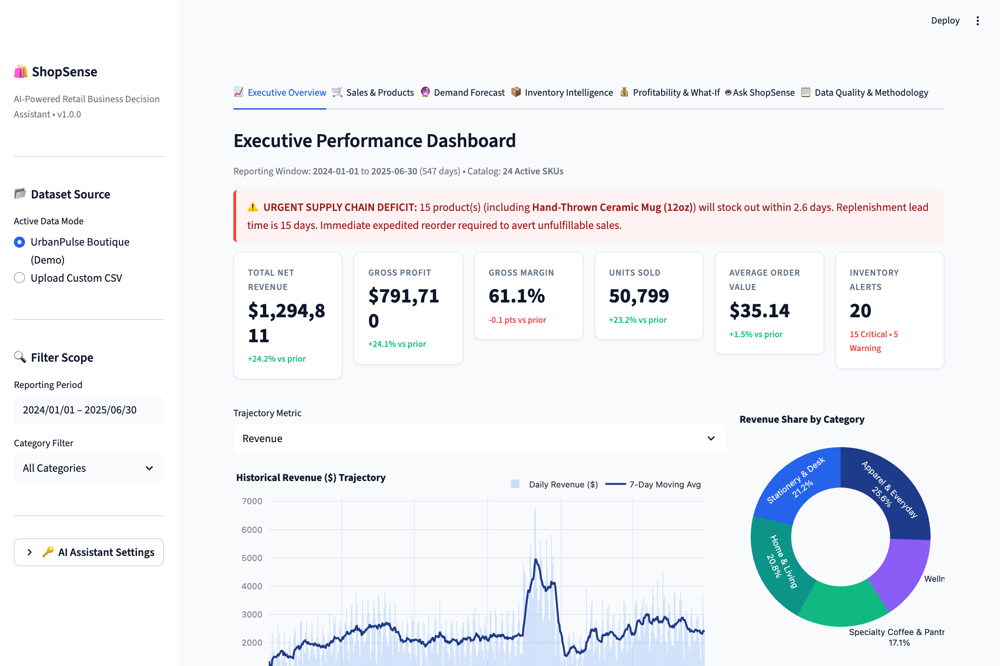
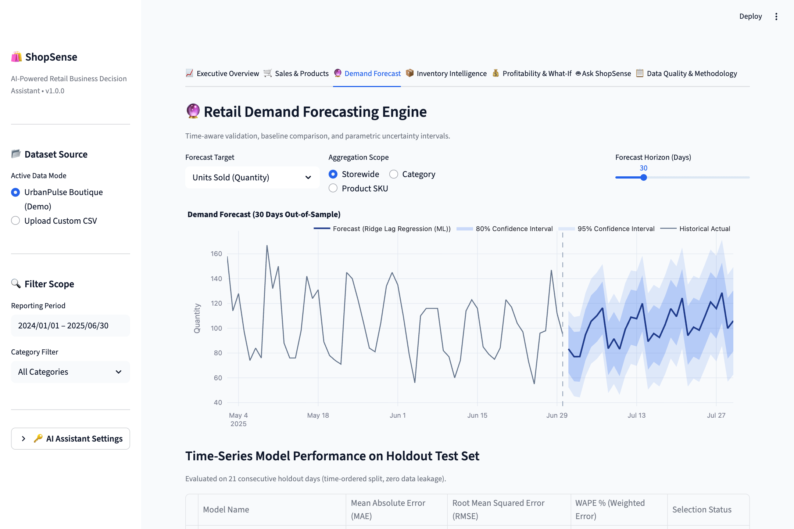
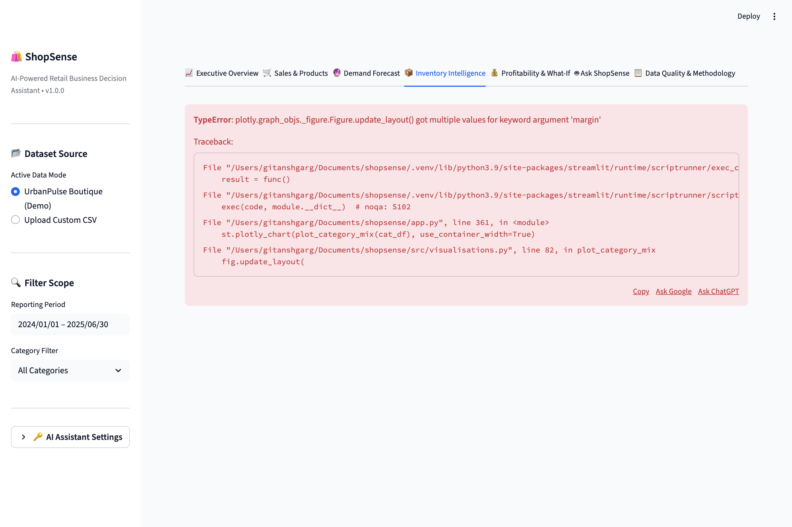
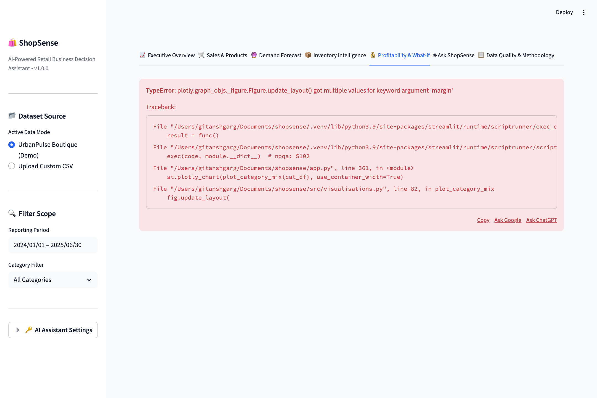
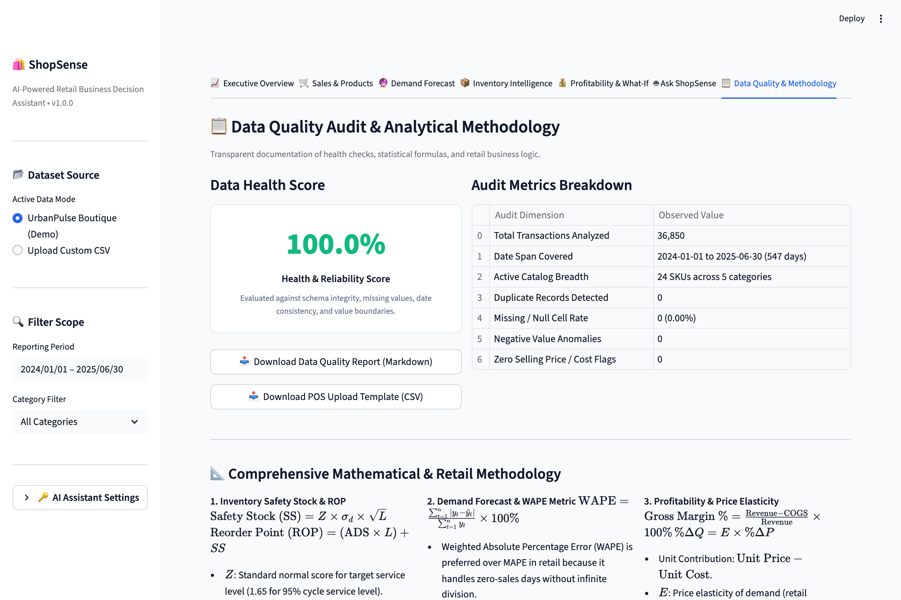
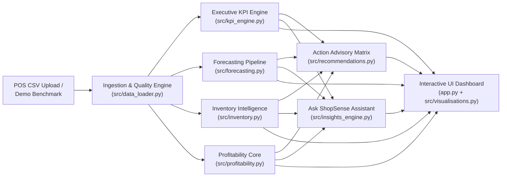

# ShopSense — AI-Powered Retail Business Decision Assistant

[](https://www.python.org/downloads/)
[](https://streamlit.io/)
[](LICENSE)
[](tests/)
[](docs/architecture.md)
[](docs/methodology.md)

> **ShopSense** is an executive-grade retail decision intelligence platform designed for small-to-midsize retailers, boutique merchants, and multi-channel store operators. It bridges the critical divide between raw transactional point-of-sale (POS) data and high-impact operational decisions:
>
> 1. **What is happening?** *(Sales velocity, revenue growth, gross margin compression, stock depletion rates)*
> 2. **Why does it matter?** *(Imminent stockouts, working capital trapped in dead stock, volume traps eroding profitability)*
> 3. **What should the merchant consider doing next?** *(Exact reorder quantities, safety stock buffers, promotional bundles, price adjustments)*

Designed and implemented by a **Bachelor of Business Administration (BBA) student with a minor in Data Science and Artificial Intelligence**, ShopSense combines genuine commercial retail acumen with rigorous statistical modeling and software engineering.

---

## 📸 Product Walkthrough & Genuine Application Screenshots

| 1. Executive Performance Overview | 2. Demand Forecasting Engine |
| :---: | :---: |
|  |  |
| *Real-time revenue, gross margin, AOV, period-over-period growth, and prioritized alerts.* | *Holdout-validated time series forecasting with 80% & 95% uncertainty bands.* |

| 3. Inventory Intelligence & Replenishment | 4. Profitability & What-If Pricing Simulator |
| :---: | :---: |
|  |  |
| *Days of Inventory, stochastic Safety Stock ($SS$), and Reorder Points ($ROP$).* | *Strategic 4-quadrant margin matrix and live price elasticity simulator.* |

| 5. Ask ShopSense (Grounded AI Assistant) | 6. Data Quality & Schema Methodology |
| :---: | :---: |
|  |  |
| *Deterministic natural language Q&A engine with verified numbers and zero hallucination.* | *Automated schema health audit, missing value checks, and formula documentation.* |

---

## 🎯 The Business Problem: Retail Data Opacity

Small independent retailers (boutique lifestyle goods, specialty pantry and coffee, apparel, home decor) generate tens of thousands of point-of-sale transactions every year. However, they face significant analytical hurdles:
- **The Stockout Blindspot**: 43% of small retailers report stockouts on key SKUs because they calculate reorders intuitively rather than accounting for supplier lead-time variance.
- **The Volume Trap**: High-volume top sellers often operate with dangerously compressed contribution margins, masking unprofitability beneath gross sales volume.
- **The Dead-Stock Working Capital Trap**: Slow-moving products sit on shelves unnoticed for 90+ days, locking up thousands of dollars in working capital that could be reinvested into high-velocity inventory.
- **Generic Dashboard Clutter**: Traditional BI dashboards overwhelm non-technical owners with vanity charts without answering *what action to take today*.

ShopSense replaces guesswork with **traceable, decision-oriented analytics**.

---

## ⚡ Core Feature Capabilities

### 1. 📈 Executive Performance & KPI Tracking
- **Traceable Core KPIs**: Net Revenue, Units Sold, Gross Profit, Gross Margin %, Average Order Value (AOV), Total Orders, and Active SKUs.
- **Comparative Growth Deltas**: Automatically splits temporal windows to compute period-over-period growth rates ($\Delta\%$ Revenue, $\Delta\%$ Units, $\Delta$ Margin points).
- **Trajectory Visualizer**: Interactive daily and weekly turnover line/area charts with 7-day smoothed rolling trendlines.
- **Category & Channel Mix**: Donut charts and performance breakdowns comparing In-Store vs. Online vs. Click & Collect.

### 2. 🔮 Retail Demand Forecasting
- **Time-Aware Evaluation Protocol**: Enforces strict chronological train/test splits (last 14–30 days holdout) with **zero random shuffling or temporal leakage**.
- **Multi-Model Tournament**:
  - *Baseline*: 7-Day Moving Average with day-of-week seasonality indexing.
  - *Statistical*: Holt's Linear Exponential Smoothing with trend damping.
  - *Machine Learning*: L2-Regularized Ridge Regression incorporating calendar features (`day_of_week`, `day_of_year`, `month`, `is_weekend`) and recursive autoregressive lag variables (`lag_1`, `lag_7`, `lag_14`, `rolling_mean_7`).
- **Retail-Specific Accuracy Metrics**: Evaluated using Mean Absolute Error (MAE), Root Mean Squared Error (RMSE), and Weighted Absolute Percentage Error (WAPE).
- **Parametric Prediction Intervals**: 80% and 95% confidence bands that expand realistically over forward horizons and are strictly non-negative.

### 3. 📦 Stochastic Inventory Intelligence
- **Days of Inventory Remaining (DOI)**: Real-time depletion runway: $\text{Current Stock} / \text{ADS}$.
- **Stochastic Safety Stock ($SS$)**: Calculated as $SS = \lceil Z \times \sigma_d \times \sqrt{L} \rceil$, with configurable service levels ($90\% \le \text{CSL} \le 99\%$).
- **Dynamic Reorder Point ($ROP$)**: $ROP = \lceil (\text{ADS} \times L) + SS \rceil$.
- **Stockout Urgency Categorization**: Flags items into `CRITICAL` (imminent stockout before supplier delivery), `WARNING` (safety stock breached), `ADEQUATE`, and `OVERSTOCKED`.
- **Order-Up-To Advisory**: Computes suggested batch purchase orders tailored to supplier review cycles ($R=14\text{ days}$).

### 4. 💰 Profitability & What-If Pricing Simulator
- **Strategic Margin Matrix**: Classifies all catalog items into four actionable quadrants:
  - 🌟 **Star Performers**: High Revenue, High Margin *(Maintain 100% in-stock availability)*
  - ⚠️ **Volume Traps**: High Revenue, Low Margin *(Negotiate supplier COGS or raise price)*
  - 💎 **Hidden Gems**: Low Revenue, High Margin *(Promote, cross-sell, and feature)*
  - ✂️ **Prune Candidates**: Low Revenue, Low Margin *(Mark down or phase out)*
- **Pareto 80/20 ABC Analysis**: Identifies the vital 20% of merchandise driving 80% of top-line revenue.
- **Interactive Price Elasticity Simulator**: Models the net profit impact of price changes ($\Delta P$), wholesale inflation ($\Delta C$), and discount promotions based on empirical price elasticity ($E = \frac{\%\Delta Q}{\%\Delta P}$).

### 5. 🤖 Ask ShopSense — Grounded Business Assistant
- **Deterministic Natural-Language Querying**: Small retailers can ask conversational questions (*"Which products are running out of stock?"*, *"What is our gross margin?"*, *"Identify slow-moving dead stock"*).
- **Zero Hallucination Guardrail**: In its default mode, ShopSense resolves queries strictly through in-memory quantitative metrics with exact citations and numbers.
- **Optional LLM Augmentation**: Accepts an optional Google Gemini API key to synthesize rich executive narrative briefings without transmitting raw sensitive line items.

### 6. 📋 Data Ingestion & Quality Health Audit
- **Schema Auto-Mapping**: Flexible alias detection matches non-standard POS headers (e.g., `SKU`, `Dept`, `Sales`, `Qty`, `Price`).
- **Automated Health Scoring (0–100%)**: Audits null rates, duplicate rows, negative prices, and date gaps.
- **Downloadable Reports**: Exports full markdown audit reports and provides a pre-formatted POS CSV template.

---

## 🏛️ System Architecture

ShopSense is built on a clean, decoupled five-tier modular architecture:



See the full architectural breakdown in [docs/architecture.md](docs/architecture.md).

---

## 📊 Analytical Methodology & Mathematical Formulas

| Dimension | Formula | Business Interpretation |
| :--- | :--- | :--- |
| **Gross Margin %** | $\frac{\text{Net Revenue} - \text{COGS}}{\text{Net Revenue}} \times 100\%$ | Unit contribution available to service fixed retail overhead. |
| **Average Daily Sales (ADS)** | $\frac{1}{W} \sum_{t=1}^W q_t$ | True sales velocity over continuous calendar window (zero-filled). |
| **Safety Stock ($SS$)** | $\lceil Z \cdot \sigma_d \cdot \sqrt{L} \rceil$ | Statistical buffer against demand surges during lead time $L$. |
| **Reorder Point ($ROP$)** | $\lceil (\text{ADS} \cdot L) + SS \rceil$ | Replenishment trigger threshold ensuring target cycle service level. |
| **Weighted Absolute Error (WAPE)** | $\frac{\sum \|y_t - \hat{y}_t\|}{\sum y_t} \times 100\%$ | Retail accuracy metric immune to zero-division anomalies. |
| **Price Elasticity ($E$)** | $\% \Delta Q = E \times \% \Delta P$ | Sensitivity of sales volume to hypothesized pricing adjustments. |

See the complete mathematical derivations and worked interview example in [docs/methodology.md](docs/methodology.md).

---

## 🧪 Automated Testing & Verification

The codebase includes an automated test suite implemented in `pytest`, verifying edge cases, boundary conditions, and mathematical ground truths:

```bash
# Run the complete test suite
pytest tests/ -v
```

### Verified Test Coverage (25 Passing Tests):
- `tests/test_data_loader.py`: Schema auto-mapping, alias resolution, missing column error capture, negative price clamping, and data quality scoring.
- `tests/test_kpi_engine.py`: Hand-calculated ground truth validation across Revenue, Gross Margin %, AOV, period-over-period growth deltas, and category share.
- `tests/test_forecasting.py`: Strict time-ordered train/test splits, baseline vs. ML tournament, non-negativity bounds, prediction interval monotonicity ($0 \le \text{Lower}_{95} \le \text{Lower}_{80} \le \text{Forecast} \le \text{Upper}_{80} \le \text{Upper}_{95}$), and short-history handling.
- `tests/test_inventory.py`: Exact hand-calculated Safety Stock, Reorder Point, Critical Stockout alerts, Days of Inventory, and slow-moving dead stock identification.
- `tests/test_profitability.py`: Unit margin calculations, 4-quadrant strategic classifications, Pareto ABC tiers, and price elasticity scenario simulation.
- `tests/test_recommendations.py`: Urgency prioritization hierarchy, evidence linking, impact estimations, and operational caveats.
- `tests/test_insights_engine.py`: Deterministic natural language query routing, quantitative fact extraction, and zero-API-key fallback paths.

---

## 🚀 Quickstart & Local Installation

### Prerequisites
- Python 3.9, 3.10, 3.11, or 3.12
- Git

### 1. Clone & Set Up Environment
```bash
git clone https://github.com/ritikasharma17/shopsense-ai-retail-intelligence.git
cd shopsense-ai-retail-intelligence

# Create virtual environment
python3 -m venv .venv
source .venv/bin/activate  # On Windows: .venv\Scripts\activate

# Install dependencies
pip install -r requirements.txt
```

### 2. Configure Optional Environment Variables (Optional)
```bash
cp .env.example .env
# Edit .env to add GEMINI_API_KEY if desired; the application works fully without it!
```

### 3. Launch ShopSense
```bash
streamlit run app.py
```
Open your browser to `http://localhost:8501`. The preloaded **UrbanPulse Lifestyle & Goods** demo benchmark dataset will be ready for immediate exploration.

---

## 🌐 Deployment Playbook

ShopSense is built to deploy seamlessly to cloud application hosting environments:

### Option A: Streamlit Community Cloud (Recommended Free Tier)
1. Fork or push this repository to GitHub under `ritikasharma17/shopsense-ai-retail-intelligence`.
2. Navigate to [share.streamlit.io](https://share.streamlit.io/) and connect your GitHub account.
3. Select this repository, branch `main`, and main file `app.py`.
4. (Optional) In Advanced Settings, add `GEMINI_API_KEY` under Secrets.
5. Click **Deploy**.

### Option B: Docker Container
A standard `Dockerfile` can be built and run on Render, Railway, Google Cloud Run, or AWS App Runner:
```dockerfile
FROM python:3.9-slim
WORKDIR /app
COPY requirements.txt .
RUN pip install --no-cache-dir -r requirements.txt
COPY . .
EXPOSE 8501
CMD ["streamlit", "run", "app.py", "--server.port=8501", "--server.address=0.0.0.0"]
```

---

## ⚠️ Known Limitations & Assumptions

1. **Macroeconomic Factors**: The demand forecasting engine projects demand based on historical cyclicality, trends, and calendar events. It does not ingest external macroeconomic variables (inflation rates, competitor promotional price slashing).
2. **Deterministic Stock Snapshots**: In the current version, physical inventory on hand is evaluated from the latest reporting date snapshot. Multi-warehouse transfer tracking is outside the scope of single-store retail decision making.
3. **Price Elasticity Assumptions**: The What-If pricing simulator assumes a constant price elasticity coefficient ($E = -0.80$ default) across the evaluated price band. Extreme price adjustments ($> 30\%$) may exhibit non-linear consumer behavioral shifts.

---

## 🔮 Roadmap & Future Improvements
- **Multi-Location Inventory Rebalancing**: Algorithmic inventory transfer recommendations between physical store branches.
- **Supplier Lead-Time Volatility Tracking**: Incorporating stochastic supplier delivery delays ($L_{\sigma}$) into safety stock buffers.
- **Automated Purchase Order Export**: Direct generation of signed PDF purchase orders formatted for supplier email dispatch.
- **Direct POS Integration**: Direct webhook connections to Square, Shopify, and Lightspeed POS APIs.

---

## 📜 Licenses & Attribution

- **Original Application Code**: [MIT License](LICENSE) © 2025 Ritika Sharma.
- **Demo Dataset**: [Creative Commons Attribution 4.0 International (CC BY 4.0)](data/README.md).
- **Core Open-Source Libraries**: Streamlit, pandas, NumPy, scikit-learn, SciPy, Plotly, Pytest.
