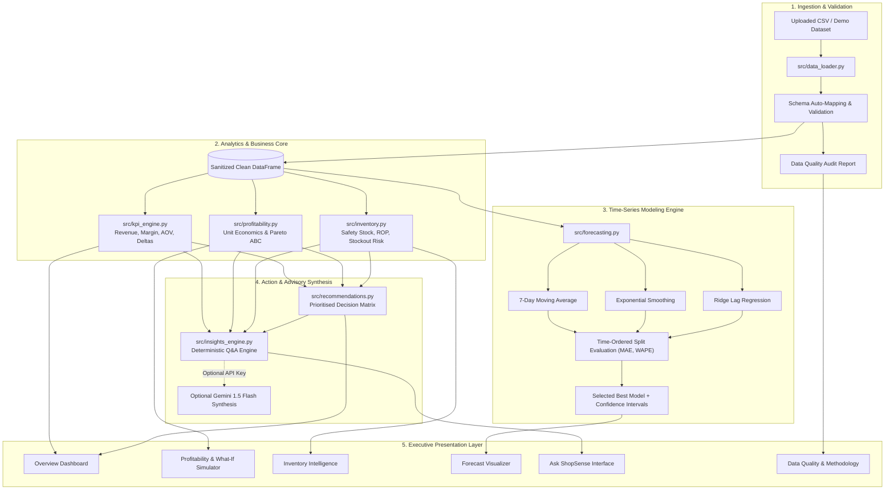

# ShopSense Technical Architecture & System Design

## 1. System Overview & Architectural Principles
ShopSense is an AI-powered retail decision intelligence system engineered for small-to-midsize retail enterprises, boutique storefronts, and multi-channel merchants. The application bridges the gap between raw point-of-sale (POS) transaction records and actionable executive decision support.

The platform follows five core architectural principles:
1. **Separation of Concerns**: Strict decoupling of data ingestion, business logic, statistical modeling, operational heuristics, and UI presentation.
2. **Deterministic Default**: Full functionality without external cloud or API dependencies; all calculations, heuristics, and natural-language queries execute locally on verified dataset facts.
3. **Traceability**: Every KPI card, alert badge, and chart coordinate is directly traceable back to specific transactional rows and documented mathematical formulas.
4. **Time-Aware Modeling**: Machine learning and time-series forecasting strictly respect temporal causality (train/test holdouts with zero random shuffling).
5. **Defensive Ingestion**: Automated schema alignment, boundary clamping, and anomaly detection prevent malformed user uploads from destabilizing the runtime.

---

## 2. Component Architecture

---

## 3. Module Responsibilities & Interfaces

### 3.1 Data Ingestion (`src/data_loader.py`)
- **Primary Function**: Ingests arbitrary CSV files from point-of-sale systems or demo fixtures.
- **Auto-Mapping**: Matches non-standard column headers (e.g., `SKU`, `Item_Name`, `Qty`, `Sales`) against canonical schema definitions using regex and normalized alias dictionaries.
- **Validation**: Enforces numeric type safety, cleans negative price/quantity anomalies, validates date continuity, and checks for row-level duplication.
- **Output**: Generates a sanitized `pd.DataFrame` alongside an immutable `DataQualityReport` object detailing completeness, health score (0–100%), and non-blocking warnings.

### 3.2 Executive KPI Engine (`src/kpi_engine.py`)
- **Primary Function**: Computes foundational financial and operational metrics.
- **Period-over-Period Delta**: Automatically partitions active timeframes into chronological halves to calculate comparative growth rates ($\Delta\%$ Revenue, $\Delta\%$ Units, $\Delta$ Margin points).
- **Aggregations**: Computes daily, weekly, and monthly resampled timeseries with 7-day rolling moving averages.

### 3.3 Inventory Intelligence (`src/inventory.py`)
- **Primary Function**: Evaluates stockout vulnerability, buffer depletion, and capital tie-up.
- **Dynamic Demand Modeling**: Calculates trailing Average Daily Sales (ADS) and daily demand standard deviation ($\sigma_d$) over a configurable trailing window (30–90 days).
- **Safety Stock ($SS$)**: $SS = \lceil Z \cdot \sigma_d \cdot \sqrt{L} \rceil$, targeting specified cycle service levels ($90\% \le \text{CSL} \le 99\%$).
- **Reorder Point ($ROP$)**: $ROP = \lceil (\text{ADS} \cdot L) + SS \rceil$.
- **Stockout Classification**: Partitions items into `CRITICAL`, `WARNING`, `ADEQUATE`, and `OVERSTOCKED`.

### 3.4 Profitability & Simulation (`src/profitability.py`)
- **Primary Function**: Analyzes SKU-level margin contributions and tests hypothetical commercial scenarios.
- **Strategic Quadrant Matrix**: Evaluates products across median revenue and store-average margin to categorize items into:
  - *Star Performers* (High Revenue, High Margin)
  - *Volume Traps* (High Revenue, Low Margin)
  - *Hidden Gems* (Low Revenue, High Margin)
  - *Prune Candidates* (Low Revenue, Low Margin)
- **What-If Scenario Simulator**: Projects revenue, COGS, and gross margin under user-defined price adjustments ($\Delta P$), wholesale cost inflation ($\Delta C$), promotional discounting, and price elasticity of demand ($E = \frac{\%\Delta Q}{\%\Delta P}$).

### 3.5 Demand Forecasting (`src/forecasting.py`)
- **Primary Function**: Generates multi-week sales volume and revenue forecasts.
- **Validation Protocol**: Strict temporal split (last 14–30 days holdout) with zero random shuffling.
- **Algorithms Compared**:
  - *Baseline*: 7-Day Moving Average with day-of-week indexing.
  - *Statistical*: Holt's Linear Exponential Smoothing.
  - *Machine Learning*: L2-regularized Ridge Regression trained on calendar features (`day_of_week`, `day_of_year`, `month`, `is_weekend`) and recursive autoregressive lag variables (`lag_1`, `lag_7`, `lag_14`, `rolling_mean_7`).
- **Metric Evaluation**: Selects champion model using holdout MAE and WAPE (Weighted Absolute Percentage Error). Generates parametric 80% and 95% confidence bands based on test residual standard error.

### 3.6 Strategic Advisory & Q&A (`src/recommendations.py`, `src/insights_engine.py`)
- **Primary Function**: Translates analytical findings into prioritized operational actions.
- **Deterministic NL Querying**: Parses natural queries regarding stockout risks, top performers, margin compression, and dead stock, formulating grounded executive summaries with exact numbers and suggested dashboard destinations.
- **Optional LLM Augmentation**: If `GEMINI_API_KEY` is provided, sends the computed factual context to Gemini 1.5 Flash for conversational executive synthesis with strict zero-hallucination prompting.

### 3.7 Visualisation Suite (`src/visualisations.py`)
- **Primary Function**: Renders responsive, accessible Plotly visualizations adhering to a bespoke corporate design system (Navy `#1E3A8A`, Blue `#2563EB`, Slate `#0F172A`, Off-White `#F8FAFC`).
- **Visuals Included**: Historical sales trajectory with rolling trendline, category mix donut, demand forecast with confidence intervals, 4-quadrant strategic margin scatter, 80/20 Pareto curve, inventory runway horizontal bar chart, and scenario impact waterfall/grouped comparison.

---

## 4. Privacy, Security & Data Sovereignty
- **No Third-Party Transmission**: In its default configuration, 100% of data processing, aggregation, model fitting, and query resolution occurs entirely within the local host environment.
- **Zero Hallucination Guardrail**: The natural-language interface cannot invent figures because all numerical metrics are derived deterministically from the pandas memory state before response generation.
- **Credential Safety**: API keys are accepted exclusively via server environment variables or isolated sidebar session inputs, never logged or written to disk.
